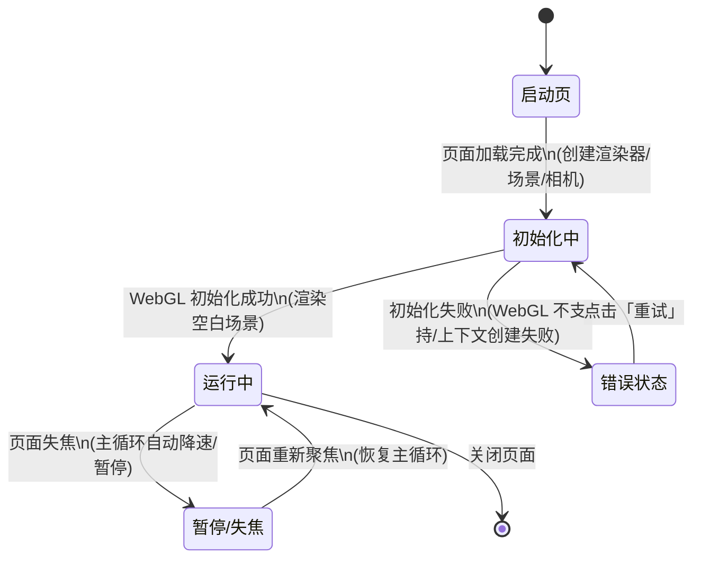

# UX 设计 — 初始化项目脚手架与技术栈

> 所属需求：WebRacing3D 可玩原型 — 核心玩法验证

## 交互流程图


```

## 组件线框说明

本工单为脚手架初始化，UI 层仅围绕渲染画布做最小可验证表面，不含 HUD 与玩法界面。主要结构：

【GameRoot 全屏容器】(单页，无路由)
├── GameCanvasRegion 游戏画布区
│   └── WebGLCanvas (Three.js 渲染画布，占满容器，由渲染器统一创建)
├── LoadingOverlay 初始化遮罩 (仅初始化阶段显示)
│   ├── LoadingSpinner 加载指示器
│   └── StatusText 状态文案 (如「正在初始化 3D 渲染…」)
└── ErrorOverlay 错误遮罩 (仅初始化失败时显示)
    ├── ErrorIllustration 错误示意
    ├── ErrorTitle 错误标题
    ├── ErrorMessage 错误说明 (区分「WebGL 不支持」与「上下文创建失败」)
    └── RetryButton 重试按钮

无侧栏/顶栏/底部导航；无弹窗面板（预留组件位置，后续 HUD 模块接入）。

## 交互状态定义

【RetryButton 重试按钮】
- normal: 可点击，触发重新初始化渲染器
- hover: 悬停高亮反馈
- active: scale 0.95 + 亮度变化
- disabled: 连续重试间隔内锁定，opacity 0.45，cursor not-allowed，防重复触发
- loading: 点击后进入初始化中，按钮显示 spinner，禁止重复点击
- error: 重试再次失败后停留于错误遮罩，文案提示「仍然失败」

【LoadingOverlay 初始化遮罩】
- loading: 显示 spinner + 状态文案
- 完成: 淡出后卸载，不残留空白

【ErrorOverlay 错误遮罩】
- error(WebGL不支持): 显示说明 + 提供「返回/了解要求」提示，不提供重试（硬件不支持重试无意义）
- error(初始化失败): 显示说明 + RetryButton

【WebGLCanvas 画布】
- normal: 渲染空白场景
- 失焦降频: 页面隐藏时暂停/降低 rAF 帧率

## 响应式/适配规则

断点：mobile < 768px / tablet 768-1024px / desktop > 1024px。
- 游戏画布全屏自适应，任意断点均铺满视口，不设固定宽高；resize 时由渲染器统一更新相机纵横比与画布尺寸。
- LoadingOverlay / ErrorOverlay 内容居中，mobile 下单列纵向布局；desktop 保持居中卡片式布局（仅结构，无视觉样式）。
- 文案：mobile 可换行缩短，desktop 完整展示。
- 触屏 (mobile/tablet)：重试按钮命中区域 ≥ 44x44px。

## UI 资产清单（初稿）

- icon: retry（重试按钮图标，24px，outline 风格）
- icon: warning（错误提示图标，24px，outline 风格）
- illustration: error-state（初始化失败/WebGL 不支持时显示，400x300，扁平风格）
- image: 暂无（本工单为空白场景，不引入美术资产）
