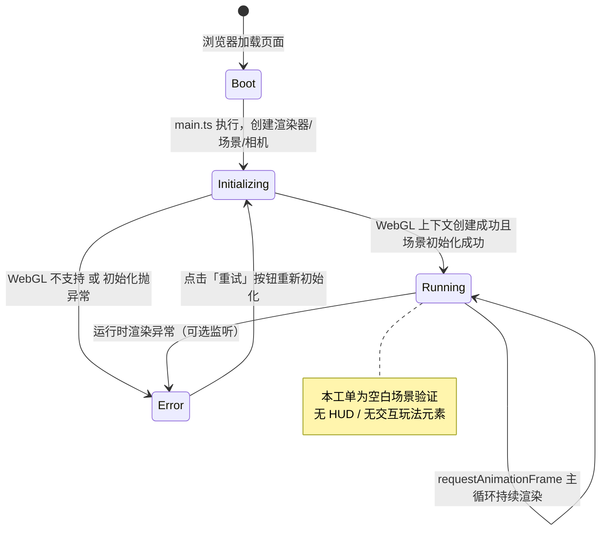

# UX 设计 — 初始化项目脚手架与技术栈

> 所属需求：WebRacing3D 可玩原型 — 核心玩法验证

## 交互流程图

## 组件线框说明

本工单为脚手架验证，无可玩 UI，页面仅由三个层级构成：

1. 根容器 #app
   - 占满视口（100vw × 100vh），overflow: hidden
   - 作为渲染器 canvas 与遮罩层的定位锚点

2. Canvas 挂载层（Three.js renderer.domElement）
   - 由 core 层统一创建，禁止各模块自行 new
   - 全屏铺满，随窗口 resize 自动更新 camera aspect 与 renderer size

3. 状态遮罩层（覆盖在 canvas 之上）
   - Loading 遮罩：加载中显示 spinner + 文案「正在初始化渲染管线…」
   - Error 遮罩：WebGL 不支持或初始化失败时显示，含错误图标 + 原因说明 + 「重试」按钮
   - Running 状态：遮罩隐藏，仅显示空白 Three.js 场景

## 交互状态定义

本工单可交互组件极少，仅「重试」按钮与两个遮罩层：

1. 重试按钮（Error 遮罩内）
   - 正常 normal：可点击
   - 悬停 hover：亮度/背景变化（游戏风格高对比反馈）
   - 按下 active：scale 0.95 + 亮度变化
   - 加载中 loading：点击后重新进入初始化，显示 spinner 并禁止重复点击
   - 禁用 disabled：初始化进行中 opacity 0.4-0.5，cursor not-allowed
   - 成功 success：初始化成功即隐藏遮罩，无需成功态
   - 空 empty / 错误 error：不适用（按钮本身无数据态）

2. Loading 遮罩
   - 状态：显示（初始化中）→ 隐藏（初始化成功）
   - 不响应交互，pointer-events 按需处理

3. Error 遮罩
   - 状态：隐藏（正常）→ 显示（WebGL 不支持 / 初始化失败）
   - 文案区分「WebGL 不支持」与「初始化异常」两类错误

4. Canvas 层
   - 状态：初始为空白，随主循环持续渲染；resize 时自适应，无交互态

## 响应式/适配规则

空白场景无复杂布局，核心规则为 canvas 全屏自适应：

- mobile（< 768px）：canvas 占满视口，遮罩文案单行/两行居中，spinner 居中
- tablet（768-1024px）：同上，全屏铺满
- desktop（> 1024px）：同上，全屏铺满

统一规则：
- 窗口 resize 时实时更新 renderer.setSize 与 camera.aspect，避免拉伸变形
- 遮罩层使用居中弹性布局，各断点无结构性差异
- 后续接入 HUD 后需补充安全区（safe-area）与横竖屏规则，本工单暂不涉及

## UI 资产清单（初稿）

- icon: loading-spinner（加载中指示器，32px，outline 风格，旋转动画）
- icon: error-alert（WebGL 不支持 / 初始化失败提示，48px，outline 风格）
- illustration: 无（空白场景无列表/空数据场景，不需要插画）
- image: 无（本工单排除所有美术资产导入）
