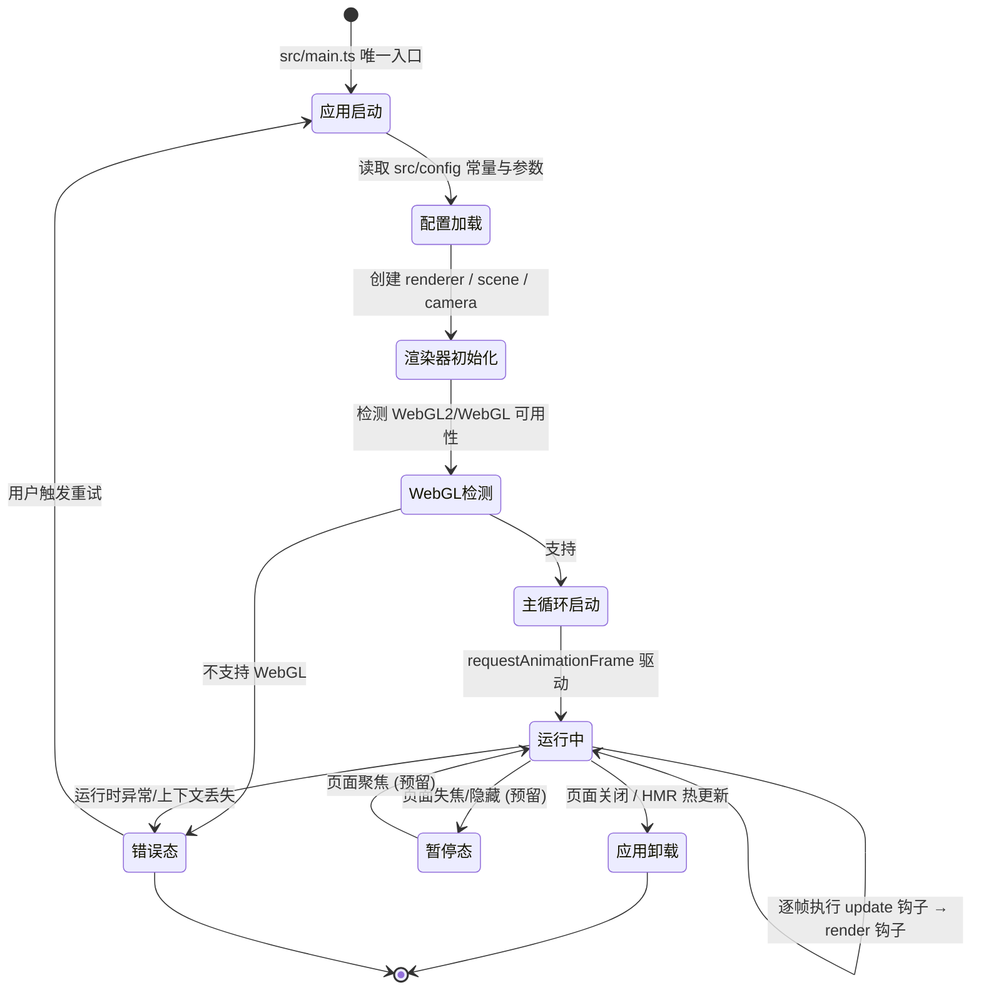

# UX 设计 — 初始化项目脚手架与技术栈

> 所属需求：WebRacing3D 可玩原型 — 核心玩法验证

## 交互流程图


```

## 组件线框说明

本工单为脚手架验证，无玩法 UI，仅建立最小可验证结构与后续挂载骨架。整体为单屏全屏 Canvas 布局，按 z 轴分层：

1. Canvas 渲染层（底层，全屏）
   - 区域：全视口 100vw × 100vh
   - 内容：Three.js WebGLRenderer 输出的空白场景（含 scene + camera 初始化成功即可视化验证）
   - 职责：纯渲染，不承载交互逻辑

2. 启动/加载占位层（中层，覆盖 Canvas 之上）
   - 组件：LoadingOverlay（半透明遮罩 + 居中 spinner）
   - 用途：覆盖「应用启动 → 渲染器初始化 → 主循环就绪」这一窗口期，避免用户看到未初始化的黑屏
   - 状态：init（初始化中）→ ready（淡出移除）

3. 错误提示层（顶层，按需出现）
   - 组件：ErrorOverlay（居中面板 + 文案 + 重试按钮）
   - 用途：WebGL 不支持、渲染器初始化失败、运行时上下文丢失三类场景
   - 结构：标题文案区 + 错误原因说明 + 主操作按钮（重试）

4. HUD 预留挂载层（顶层容器，本工单仅占位不实现）
   - 组件：HudRoot（绝对定位空容器，透明 pointer-events:none）
   - 用途：为后续速度表/圈数/计时器等模块提供统一挂载点，避免各模块各自创建根节点

5. 调试信息条（可选，开发环境）
   - 组件：DebugBar（左下角，展示 FPS / frame time / 渲染对象数）
   - 用途：验证验收标准第 8 条（空白场景 ≥ 60fps）

## 交互状态定义

本工单可交互组件仅两类，其余为被动展示层：

### 重试按钮（RetryButton，错误态使用）
- normal：默认可点击，文案「重试」
- hover：鼠标悬停，背景亮度 +5%
- active：按下 scale 0.95 + 亮度变化
- disabled：重试进行中禁用，opacity 0.45 + cursor not-allowed，防止重复点击
- loading：显示 spinner，文案「正在重新初始化…」
- （success/empty 状态本阶段不适用）

### 应用根（AppRoot，即整屏游戏画布）
- normal/运行中：主循环稳定驱动，空白场景持续渲染
- loading（初始化）：显示 LoadingOverlay，期间无帧内容输出，防黑屏
- error：显示 ErrorOverlay，主循环暂停，不产生 requestAnimationFrame 空转
- paused（预留）：页面失焦时暂停 update 渲染，聚焦恢复，用于后续节流
- ready：LoadingOverlay 淡出，进入纯渲染态

### 调试信息条（DebugBar，可选）
- normal：显示 FPS / frame time / 对象数
- empty：数据未就绪时显示占位「--」

### 状态切换规则
- LoadingOverlay 出现/消失用 fade 150-200ms
- ErrorOverlay 出现从下向上 + fade 200ms，消失 fade out 150ms
- 运行中 → 错误态为单向，仅能通过重试按钮回到「应用启动」

## 响应式/适配规则

全屏游戏画布以视口自适应为唯一布局原则，无内容换行需求：

- mobile < 768px：Canvas 填满视口，devicePixelRatio 按屏幕实际值上限 2 处理（避免高分屏过重），错误面板宽度 80%，字体与按钮按触控友好尺寸（最小点击区 44×44px）
- tablet 768-1024px：Canvas 填满视口，错误面板宽度 50%，居中
- desktop > 1024px：Canvas 填满视口，错误面板固定最大宽 480px 居中

通用规则：
1. 监听 window resize，动态更新 renderer.setSize 与 camera.aspect，保证任意断点无拉伸变形
2. 页面失焦（visibilitychange / blur）暂停主循环，聚焦恢复（预留节流逻辑）
3. 全屏画布优先，不引入滚动条；错误面板为唯一滚动例外
4. 所有绝对定位层（Loading/Error/HudRoot）覆盖同一坐标系，随视口同步缩放

## UI 资产清单（初稿）

本工单为脚手架验证，按边界条件不引入美术资产，仅保留必要的功能图标占位：

- icon: warning（WebGL 不支持 / 初始化失败错误提示，24px，outline 风格，用于 ErrorOverlay 标题左侧）
- icon: refresh（重试按钮图标，24px，outline 风格，loading 时旋转为 spinner）
- icon: info（调试信息条占位图标，16px，outline 风格，可省略）
- illustration: empty-state（本阶段不适用，后续列表类模块预留，400×300）
- image: 无（本工单明确禁止美术资产导入）

补充说明：以上 icon 建议暂以系统字体符号或内联 SVG 占位，正式美术资产留待后续 UI 模块工单统一交付。
