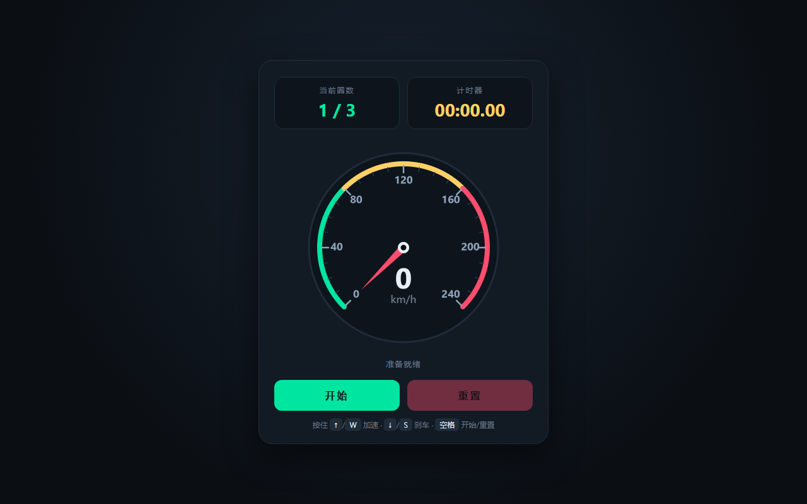

# 产品验收 — 初始化项目脚手架与技术栈

## 结果: ❌ 不通过

| 项目 | 值 |
|------|------|
| 评分 | 4/10 (通过线: 6) |
| 状态 | acceptance_rejected |

## 反馈
本工单交付物未完成。类型定义层（src/types/index.ts、input.ts）与共享工具层（src/utils/time.ts）已交付且质量良好，目录结构（camera/physics/player/race/types/utils）齐全，src/main.ts 与 src/index.ts 两个入口文件代码完整。但作为「Vite + TypeScript + Three.js 脚手架」的核心环节存在关键缺失，导致骨架实际不可用：一、明确产出文件 vite.config.ts 与 docs/Reqs/a8d042/48b6af/dev-notes.md 均不存在（7 个承诺产出缺失 2 个）；二、package.json 未声明 three/typescript/@types/three 依赖，而 src/main.ts 与 src/index.ts 均 `import * as THREE from 'three'`，npm install 后构建必然失败；三、index.html 未通过 `<script type=module src="/src/main.ts">` 引用入口，Three.js 骨架与页面完全脱节——当前页面能正常渲染，依赖的是 index.html 内联的自包含静态仪表盘脚本（Canvas 速度表 + 计时器），与本工单的 Three.js 骨架无关。因此「统一入口」并未真正接通，脚手架尚未达到可运行状态。

## 检查清单
  1. 页面能否正常打开
  2. 功能是否符合需求描述
  3. 界面是否美观合理

## 运行效果截图

## 问题
- vite.config.ts 缺失：本工单明确产出文件之一不存在，Vite 项目无配置文件（虽有默认值，但属承诺交付物缺失）。
- dev-notes.md 缺失：docs/Reqs/a8d042/48b6af/ 目录整体不存在，开发备注文档未交付。
- package.json 未声明 three / typescript / @types/three 依赖：src/main.ts、src/index.ts 的 `import * as THREE from 'three'` 无法解析，npm run build / dev 必然失败，技术栈依赖未落地。
- index.html 未引用 src/main.ts：无 `<script type=module>` 入口，Three.js 骨架代码从未被加载执行，页面渲染的是内联静态仪表盘，与骨架脱节。
- 共享工具层未真正沉淀：src/main.ts 内大量工具函数（createRenderer/createCamera/createLights/getSize）内联定义，未复用 src/utils/，与「统一共享工具层」目标不符。
