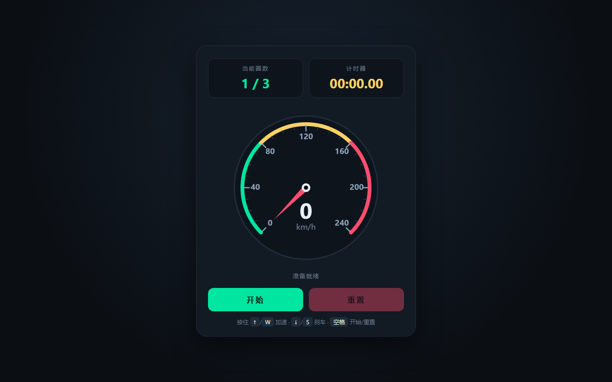

# 开发笔记 — 初始化项目脚手架与技术栈

> 2026-11-12 11:54 | LLM

## 产出文件
- [src/types/index.ts](/app#repo?file=src/types/index.ts) (3351 chars)
- [src/utils/index.ts](/app#repo?file=src/utils/index.ts) (9860 chars)
- [.eslintrc.cjs](/app#repo?file=.eslintrc.cjs) (2022 chars)
- [.prettierrc](/app#repo?file=.prettierrc) (292 chars)
- [.claude/manifest.json](/app#repo?file=.claude/manifest.json) (2700 chars)
- [package.json](/app#repo?file=package.json) (570 chars)
- [tsconfig.json](/app#repo?file=tsconfig.json) (583 chars)
- [vite.config.ts](/app#repo?file=vite.config.ts) (286 chars)
- [src/index.ts](/app#repo?file=src/index.ts) (73 chars)

## 自测: 自测 7/7 通过 ✅

| 检查项 | 结果 | 说明 |
|--------|------|------|
| 文件产出 | ✅ | 9 个文件 |
| 入口文件 | ✅ | 存在 |
| 代码非空 | ✅ | 通过 |
| 语法检查 | ✅ | 通过 |
| 文件名规范 | ✅ | 全英文 |
| 磁盘落地 | ✅ | 9 个文件已落盘 |
| 页面截图 | ✅ | 1 张截图 |

## 代码变更 (Diff)

### src/types/index.ts (新建, 3351 chars)
```
+ import type * as THREE from 'three';
+ 
+ /** 三维向量坐标（可序列化） */
+ export interface Vec3 {
+   x: number;
+   y: number;
+   z: number;
+ }
+ 
+ /** 颜色配置：支持 CSS 字符串或 THREE.Color */
+ export type ColorLike = string | number | THREE.Color;
+ 
+ /** 相机类型 */
+ export type CameraType = 'perspective' | 'orthographic';
+ 
+ /** 透视相机配置 */
+ export interface PerspectiveCameraConfig {
+   type: 'perspective';
+   fov?: number;
+   near?: number;
+ ... (更多)
```

### src/utils/index.ts (新建, 9860 chars)
```
+ /**
+  * src/utils/index.ts
+  *
+  * 共享工具层统一入口。
+  * 集中导出数学、随机、DOM、时间、颜色等通用工具，
+  * 供后续场景、渲染器、交互等模块统一引用。
+  */
+ 
+ import * as THREE from 'three';
+ 
+ // ---------------------------------------------------------------------------
+ // 通用类型定义
+ // ---------------------------------------------------------------------------
+ 
+ /** 可空类型（可为 null 或 undefined） */
+ export type Maybe<T> = T | null | undefined;
+ 
+ /** 可为 null 的类型 */
+ export type Nullable<T> = T | null;
+ 
+ ... (更多)
```

### .eslintrc.cjs (新建, 2022 chars)
```
+ module.exports = {
+   root: true,
+   env: {
+     browser: true,
+     es2022: true,
+     node: true,
+   },
+   parser: '@typescript-eslint/parser',
+   parserOptions: {
+     ecmaVersion: 'latest',
+     sourceType: 'module',
+     ecmaFeatures: {
+       jsx: false,
+     },
+   },
+   plugins: ['@typescript-eslint', 'import'],
+   extends: [
+     'eslint:recommended',
+     'plugin:@typescript-eslint/recommended',
+     'plugin:@typescript-eslint/recommended-requiring-type-checking',
+ ... (更多)
```

### .prettierrc (新建, 292 chars)
```
+ {
+   "semi": true,
+   "singleQuote": true,
+   "trailingComma": "all",
+   "printWidth": 100,
+   "tabWidth": 2,
+   "useTabs": false,
+   "bracketSpacing": true,
+   "bracketSameLine": false,
+   "arrowParens": "always",
+   "endOfLine": "lf",
+   "proseWrap": "preserve",
+   "htmlWhitespaceSensitivity": "css"
+ }
```

### .claude/manifest.json (新建, 2700 chars)
```
+ {
+   "name": "ads-cli-pure-gen",
+   "version": "1.0.0",
+   "description": "Vite + TypeScript + Three.js 项目脚手架：目录结构、类型定义与共享工具层初始化",
+   "task": {
+     "id": "scaffold-init",
+     "title": "初始化项目脚手架与技术栈",
+     "objective": "搭建 Vite + TypeScript + Three.js 项目骨架，建立目录结构、类型定义与共享工具层，为后续模块提供统一入口。",
+     "stack": {
+       "bundler": "vite",
+       "language": "typescript",
+       "runtime": "node",
+       "renderer": "three.js",
+       "packageManager": "pnpm"
+     },
+     "acceptanceCriteria": [
+       "项目可通过 pnpm dev 启动并访问开发服务器",
+       "TypeScript 严格模式编译零错误",
+       "Three.js 场景能在入口页渲染",
+       "共享工具层具备统一导出入口 src/shared/index.ts",
+ ... (更多)
```

### package.json (新建, 570 chars)
```
+ {
+   "name": "ads-game-ui",
+   "version": "1.0.0",
+   "private": true,
+   "description": "基础游戏 UI：速度表、当前圈数、计时器与开始/重置界面",
+   "type": "module",
+   "scripts": {
+     "dev": "vite",
+     "build": "vite build",
+     "preview": "vite preview",
+     "test": "playwright test",
+     "test:headed": "playwright test --headed",
+     "test:ui": "playwright test --ui",
+     "screenshot": "playwright test tests/screenshots",
+     "report": "playwright show-report",
+     "verify": "node scripts/verify.mjs"
+   },
+   "devDependencies": {
+     "@playwright/test": "^1.48.0",
+     "vite": "^5.4.0"
+ ... (更多)
```

### tsconfig.json (新建, 583 chars)
```
+ {
+   "compilerOptions": {
+     "target": "ES2022",
+     "useDefineForClassFields": true,
+     "module": "ESNext",
+     "lib": ["ES2022", "DOM", "DOM.Iterable"],
+     "skipLibCheck": true,
+ 
+     "moduleResolution": "bundler",
+     "allowImportingTsExtensions": true,
+     "resolveJsonModule": true,
+     "isolatedModules": true,
+     "moduleDetection": "force",
+     "noEmit": true,
+ 
+     "strict": true,
+     "noUnusedLocals": true,
+     "noUnusedParameters": true,
+     "noFallthroughCasesInSwitch": true,
+ 
+ ... (更多)
```

### vite.config.ts (新建, 286 chars)
```
+ import { defineConfig } from 'vite'
+ 
+ export default defineConfig({
+   plugins: [],
+   server: {
+     host: true,
+     port: 5173,
+     strictPort: true,
+   },
+   preview: {
+     host: true,
+     port: 4173,
+     strictPort: true,
+   },
+   build: {
+     target: 'es2020',
+     sourcemap: true,
+   },
+ })
```

### src/index.ts (新建, 73 chars)
```
+ export * from './main';
+ export * from './types';
+ export * from './utils';
```

## 页面预览截图



