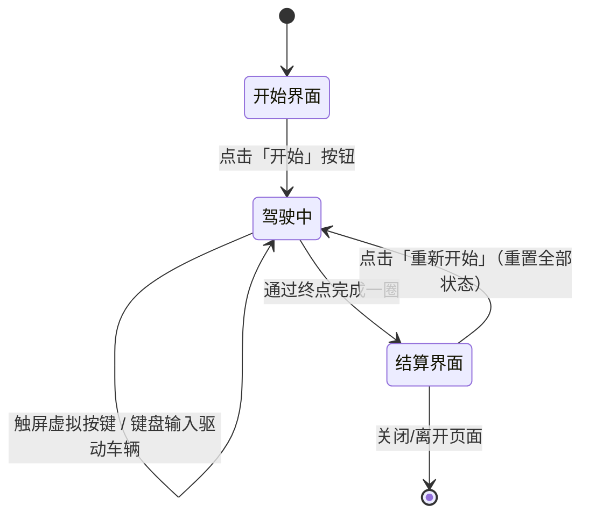

# UX 设计 — 实现基础游戏 UI

> 所属需求：WebRacing3D 可玩原型 — 核心玩法验证

## 交互流程图


```

## 组件线框说明

页面采用三层结构：底层为 3D 渲染画布（canvas），中层为 HUD 覆盖层（绝对定位，pointer-events 穿透），顶层为可交互浮层（开始界面/结算界面/触屏按键，接收点击）。

【HUD 覆盖层】
- 顶部左：圈数面板（Label『圈数』 + 数值「当前圈 / 总圈数」）
- 顶部中/右：计时器面板（Label『本圈时间』 + 数值「分:秒.毫秒」，等宽数字）
- 底部中央：速度表面板（数值整数 km/h + 单位「km/h」）
- HUD 各面板为只读展示，订阅 service/store，禁止组件内计算，pointer-events: none

【开始界面】
- 全屏遮罩（半透明）
- 居中容器：标题（游戏名）+ 副标题/说明文案 + 主按钮「开始」

【结算界面】
- 全屏遮罩（半透明）
- 居中容器：标题「单圈完成」+ 成绩展示（单圈时间，与计时器最终值一致）+ 主按钮「重新开始」

【触屏虚拟按键层】（仅移动端触摸设备显示）
- 左侧：左/右转向按键
- 右侧：加速键 + 刹车键（可长按）
- 各按键绑定 pointerdown/pointerup/pointercancel，接入与键盘相同的输入 service

【输入 service】
- 统一抽象键盘（W/↑、S/↓、A/D/←→）与触屏按键，输出同一套 throttle/brake/steer 指令

## 交互状态定义

【开始按钮 / 重新开始按钮】
- normal：默认可点击，主操作样式
- hover：Web 端鼠标悬停反馈（背景/亮度变化）
- active/pressed：scale 0.95 + 亮度降低，触摸/点击按下反馈
- disabled：opacity 0.4-0.5 + cursor not-allowed，不响应点击（如状态切换过渡期间短暂锁定防重复触发）
- loading：显示 spinner，禁止重复点击（点击后到驾驶状态切换的过渡窗口内）
- 无 empty/error 状态（本地单机，无数据加载与网络失败）

【触屏虚拟按键：加速 / 刹车 / 左转 / 右转】
- normal：默认可按下
- active/pressed：按下时 scale 0.9 + 高亮，持续输出指令（长按加速、松开停止）
- disabled：不显示（桌面端）或不可用状态
- hover：桌面端不显示该层，无需 hover
- 无 loading/empty/error 状态

【HUD 展示组件（速度表/圈数/计时器）】
- 只读展示，无交互，无 hover/active/disabled
- 数据实时刷新（速度 ≥30 次/秒，计时器毫秒 3 位持续递增）
- 速度表异常态：无 NaN/负值显示；倒车时显示 0 或明确倒车标识（error/fallback 保护）
- 圈数/计时器无 empty 状态（初始即「1 / 1」、00:00.000）

【页面级状态】
- 首次加载：≤1000ms 内显示开始界面（无需骨架屏，本地即时）
- 状态切换动效：开始→驾驶淡出 ≤300ms；结算弹窗从下向上 + fade 200ms；关闭 fade out 150ms

## 响应式/适配规则

断点：mobile < 768px / tablet 768-1024px / desktop > 1024px。

【mobile < 768px】
- 触屏虚拟按键层显示（触摸设备），按键尺寸 ≥ 64px 保证可触达
- HUD 采用紧凑布局：速度表居中偏下，圈数/计时器位于顶部左右
- 开始/结算界面容器宽度 ≈ 85vw，文字字号相对缩小

【tablet 768-1024px】
- 触屏虚拟按键在有触摸能力的平板显示，桌面/键鼠平板不强制
- HUD 布局与桌面一致，面板间距适中

【desktop > 1024px】
- 触屏虚拟按键层不显示，仅使用键盘（W/↑、S/↓、A/D/←→）
- HUD 完整布局：圈数左上、计时器顶部中央、速度表底部中央
- 开始/结算界面容器最大宽度限制（如 480px）居中

【通用】
- HUD 面板使用安全区（safe-area-inset），避免刘海/圆角遮挡
- 速度表与计时器数字使用 tabular-nums / 等宽字体，防止抖动

## UI 资产清单（初稿）

- icon: start-play（开始按钮图标，24px，outline 风格，可用 CSS/矢量实现）
- icon: restart（重新开始按钮图标，24px，outline 风格，可用 CSS/矢量实现）
- icon: steer-left（左转虚拟按键，48px，outline 风格）
- icon: steer-right（右转虚拟按键，48px，outline 风格）
- icon: throttle（加速虚拟按键，48px，filled 风格）
- icon: brake（刹车虚拟按键，48px，filled 风格）
- illustration: 无（本工单不需要插画，开始/结算界面以文字 + 按钮为主）
- image: 无（HUD 与界面全部用 CSS/DOM 元素绘制，避免额外纹理加载）
- font: 数字等宽字体（monospace 或系统 tabular-nums，用于速度表/计时器数字，防止抖动）
