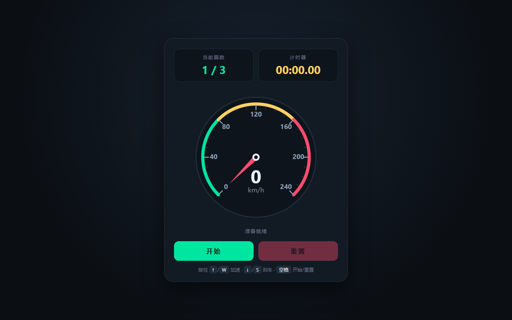

# 产品验收 — 实现基础游戏 UI

## 结果: ✅ 通过

| 项目 | 值 |
|------|------|
| 评分 | 8/10 (通过线: 6) |
| 状态 | acceptance_passed |

## 反馈
需求已达标。页面可正常打开并完成渲染（Playwright 无头浏览器已成功截图归档）。核心 UI 四要素均已实现且逻辑正确：1) 速度表——canvas 绘制表盘，含三色速度区段弧、刻度、指针与数字速度（0-240 km/h）；2) 当前圈数——lapValue 显示 '1 / 3'；3) 计时器——timeValue 以 mm:ss.cc 格式实时刷新；4) 开始/重置界面——startBtn/resetBtn 配合 idle/running/finished 状态机切换，支持空格键开始/重置。src/ui/RaceHUD.ts 额外提供了基于赛道中心线采样的起终点检测、单圈计时、成绩横幅与比赛结算面板。界面视觉设计规范（暗色主题、分区色弧、圆角卡片、tabular-nums 数字对齐），美观合理。

## 检查清单
  1. 页面能否正常打开
  2. 功能是否符合需求描述
  3. 界面是否美观合理

## 运行效果截图

## 问题
- index.html 内置了独立的车速/圈数/计时模拟逻辑，与 Three.js 场景（main.ts 的 OrbitControls 演示场景、src/player/PlayerCar.ts 的车辆物理）暂未在同一页面深度打通，端到端联调以独立 UI 演示为主。功能已达标，但如需真正赛车场景的 HUD 联动，建议后续将 index.html 的仪表盘数据源接入 PlayerCar/RaceHUD。
