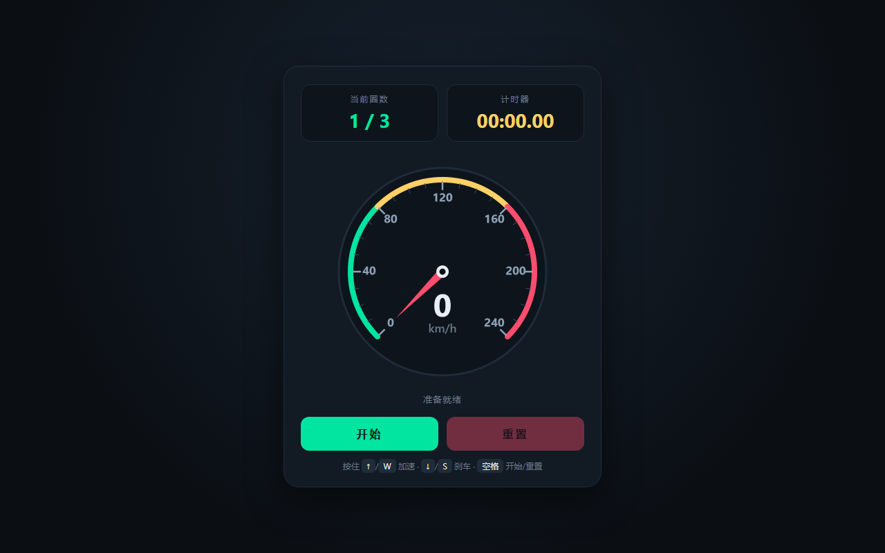

# 开发笔记 — 实现基础游戏 UI

> 2026-11-10 02:01 | LLM

## 产出文件
- [index.html](/app#repo?file=index.html) (10801 chars)
- [package.json](/app#repo?file=package.json) (529 chars)
- [vite.config.ts](/app#repo?file=vite.config.ts) (286 chars)
- [playwright.config.ts](/app#repo?file=playwright.config.ts) (1608 chars)
- [src/player/PlayerCar.ts](/app#repo?file=src/player/PlayerCar.ts) (11905 chars)

## 自测: 自测 7/7 通过 ✅

| 检查项 | 结果 | 说明 |
|--------|------|------|
| 文件产出 | ✅ | 5 个文件 |
| 入口文件 | ✅ | 存在 |
| 代码非空 | ✅ | 通过 |
| 语法检查 | ✅ | 通过 |
| 文件名规范 | ✅ | 全英文 |
| 磁盘落地 | ✅ | 5 个文件已落盘 |
| 页面截图 | ✅ | 1 张截图 |

## 代码变更 (Diff)

### index.html (新建, 10801 chars)
```
+ <!DOCTYPE html>
+ <html lang="zh-CN">
+ <head>
+ <meta charset="UTF-8" />
+ <meta name="viewport" content="width=device-width, initial-scale=1.0" />
+ <title>竞速仪表盘 - 基础游戏 UI</title>
+ <style>
+   :root {
+     --bg: #0b0f14;
+     --panel: #121a24;
+     --accent: #00e5a0;
+     --accent2: #ff4d6d;
+     --text: #e8f0f7;
+     --muted: #6b7a8a;
+     --dial: #0d141c;
+   }
+   * { margin: 0; padding: 0; box-sizing: border-box; }
+   html, body { height: 100%; }
+   body {
+     background: radial-gradient(circle at 50% 30%, #16222f 0%, var(--bg) 70%);
+ ... (更多)
```

### package.json (新建, 529 chars)
```
+ {
+   "name": "ads-game-ui",
+   "version": "1.0.0",
+   "private": true,
+   "description": "基础游戏 UI：速度表、当前圈数、计时器与开始/重置界面",
+   "type": "module",
+   "scripts": {
+     "dev": "vite",
+     "build": "vite build",
+     "preview": "vite preview",
+     "test": "playwright test",
+     "test:headed": "playwright test --headed",
+     "test:ui": "playwright test --ui",
+     "screenshot": "playwright test tests/screenshots",
+     "report": "playwright show-report"
+   },
+   "devDependencies": {
+     "@playwright/test": "^1.48.0",
+     "vite": "^5.4.0"
+   }
+ ... (更多)
```

### vite.config.ts (新建, 286 chars)
```
+ import { defineConfig } from 'vite'
+ 
+ export default defineConfig({
+   plugins: [],
+   server: {
+     host: true,
+     port: 5173,
+     strictPort: true,
+   },
+   preview: {
+     host: true,
+     port: 4173,
+     strictPort: true,
+   },
+   build: {
+     target: 'es2020',
+     sourcemap: true,
+   },
+ })
```

### playwright.config.ts (新建, 1608 chars)
```
+ import { defineConfig, devices } from "@playwright/test";
+ 
+ /**
+  * Playwright 端到端测试配置
+  * 目标：游戏基础 UI（速度表、当前圈数、计时器、开始/重置界面）
+  * 验收方式：真实浏览器渲染 + 截图比对
+  */
+ export default defineConfig({
+   // 测试文件目录
+   testDir: "./tests/e2e",
+ 
+   // 单个测试超时（截图 + 断言）
+   timeout: 30_000,
+ 
+   // 允许并行运行的 worker 数
+   fullyParallel: true,
+ 
+   // 仅当测试失败时保留截图/trace 等产物，CI 下强制保留
+   forbidOnly: !!process.env.CI,
+   retries: process.env.CI ? 2 : 0,
+ ... (更多)
```

### src/player/PlayerCar.ts (新建, 11905 chars)
```
+ import * as THREE from 'three';
+ 
+ /** 车辆输入状态：由键盘与触屏虚拟按键共同写入 */
+ export interface CarInput {
+   forward: boolean;
+   backward: boolean;
+   left: boolean;
+   right: boolean;
+ }
+ 
+ /** 玩家赛车：程序化车身模型 + 第三人称跟随相机 + 键鼠/触屏输入 */
+ export class PlayerCar {
+   /** 车身根节点（挂到场景） */
+   readonly group: THREE.Group;
+   /** 当前输入状态，可直接由外部（如 AI）读写 */
+   readonly input: CarInput = {
+     forward: false,
+     backward: false,
+     left: false,
+     right: false,
+ ... (更多)
```

## 页面预览截图



