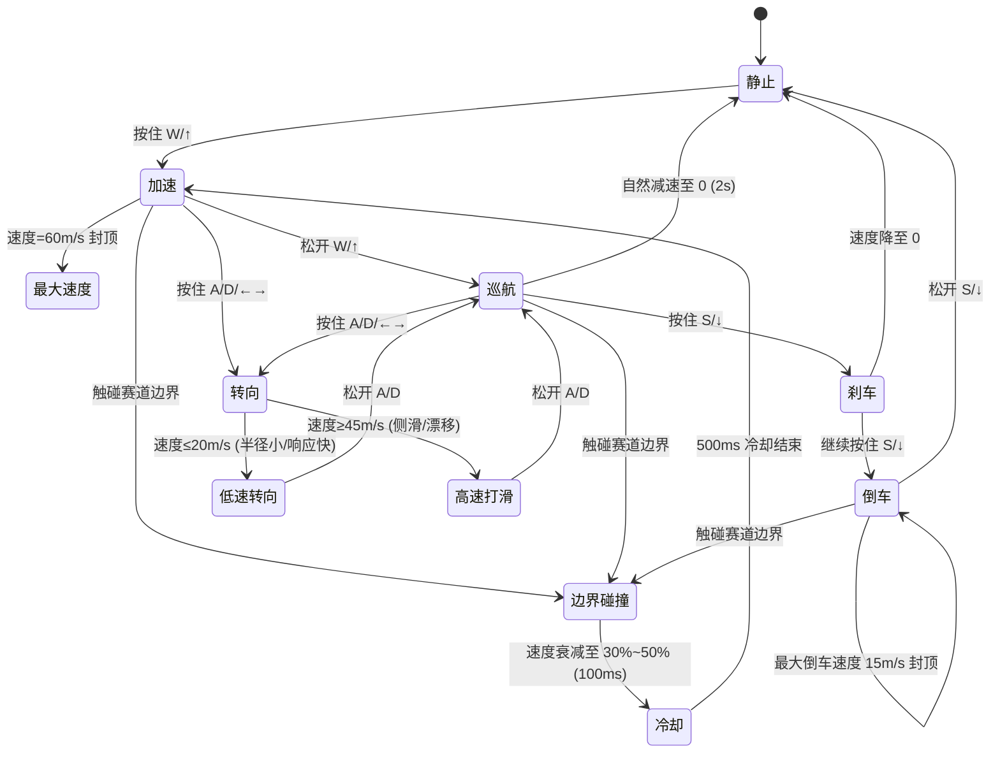

# UX 设计 — 实现基础车辆物理系统

> 所属需求：WebRacing3D 可玩原型 — 核心玩法验证

## 交互流程图



说明：本工单为纯物理逻辑，不涉及页面跳转，交互流程描述的是**车辆物理状态机**。输入经 InputLayer 归一化为油门(-1~1)/转向(-1~1)后驱动 PhysicsSystem 状态迁移，渲染层仅消费物理层输出的位姿与速度，实现固定时间步长(与帧率解耦)。
```

## 组件线框说明

本工单无页面级 UI，聚焦物理层对外暴露的输入/输出接口与最小反馈 HUD 结构。

### 1. 输入映射层 (InputLayer)
- 前进：W / ↑ → 油门 +1
- 后退/刹车：S / ↓ → 油门 -1
- 转向：A / ← 左转 -1，D / → 右转 +1
- 组合判定：同时按下前进+刹车 → 油门归零（中性）
- 输出：标准化 InputState { throttle: -1~1, steer: -1~1 }

### 2. 物理引擎层 (PhysicsSystem)
- 固定时间步长更新循环 (fixedDelta 1/60s，累积器与渲染解耦)
- 速度/加速度积分、转向角速度、抓地力衰减曲线、边界碰撞检测与冷却
- 参数集中收敛于共享配置对象 VehicleConfig

### 3. 最小反馈 HUD（供后续工单接入，本工单仅预留数据接口）
- 速度仪表区：当前速度 / 最大速度 / 倒车标识
- 打滑指示区：侧滑角实时显示（高速转向时高亮）
- 碰撞反馈区：碰撞瞬间屏幕震动 + 速度衰减提示

### 4. 调试面板（可选，本地验证用）
- 显示油门/转向输入值、抓地力系数、碰撞冷却剩余时间

## 交互状态定义

本工单交互组件为「键盘输入键」与「反馈 HUD 指示」，各状态如下：

### 键盘输入（油门/刹车/转向键）
- 默认：未按下，油门 0 / 转向 0，车辆自然减速或静止
- 按下(active)：持续累加油门或持续转向（加速曲线连续无突变）
- 释放：油门归零，进入滚动/空气阻力自然减速
- 组合按下：前进+刹车同时 → 中性（油门归零）

### 车辆物理状态（对应 HUD 反馈）
- 静止：速度 0，无输入
- 加速中：速度单调上升至 60m/s 封顶
- 巡航：无油门，自然减速（2s 内归零）
- 刹车/倒车中：减速至 0 后进入倒车（≤15m/s）
- 低速转向：速度≤20m/s，转向角速度≥1.5rad/s，无侧滑
- 高速打滑：速度≥45m/s，侧滑角≥8°，抓地力随速度单调递减
- 碰撞冷却：速度衰减 30%~50%，500ms 内不重复扣速

### 反馈指示状态
- 速度表：正常 / 加速高亮 / 倒车标识
- 打滑指示：正常隐藏 / 侧滑角≥8° 时高亮
- 碰撞提示：正常 / 触发（100ms 衰减）/ 冷却中（500ms 置灰）

## 响应式/适配规则

本工单以键盘输入为主，触屏虚拟按键不在本工单范围内（由后续工单实现）。

- desktop > 1024px：键盘输入（W/S/A/D 或方向键），HUD 完整展示，调试面板可见
- tablet 768-1024px：键盘为主，若外接键盘缺失则预留触屏输入接口（本工单仅定义 InputState 协议，不绘制虚拟按键）
- mobile < 768px：触屏虚拟按键 UI 由后续工单绘制；本工单保证物理层输出的 InputState 协议与触屏输入兼容（throttle/steer 归一化范围一致）

核心约束：所有档位下物理更新采用固定时间步长，60Hz/120Hz 刷新率下轨迹误差 ≤1%。

## UI 资产清单（初稿）

本工单为纯代码物理逻辑，无必需美术资产。以下为可选/预留资产（供后续 HUD 工单使用）：

- icon: speedometer（速度仪表，24px，outline 风格）
- icon: drift（打滑/侧滑指示，24px，outline 风格）
- icon: reverse（倒车标识，24px，outline 风格）
- icon: collision-warning（碰撞警示，24px，outline 风格）
- icon: debug（调试面板开关，24px，outline 风格）
- illustration: 无（本工单无空状态/列表场景）
- image: 无（本工单无页面级横幅/背景）
