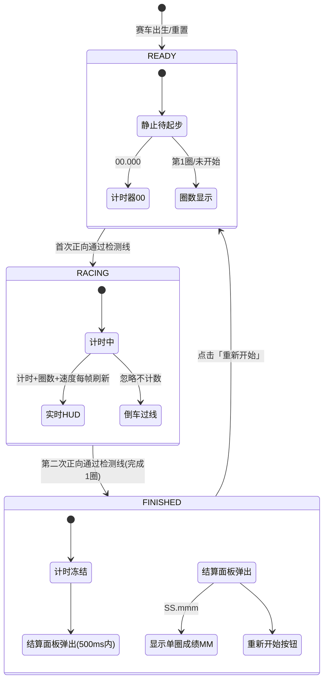

# UX 设计 — 实现计时与圈数系统

> 所属需求：WebRacing3D 可玩原型 — 核心玩法验证

## 交互流程图



**流程说明**：
1. 出生 → READY：计时器恒为 00:00.000，圈数显示「第 1 圈」，不随车辆移动变化。
2. 首次正向过线 → RACING：计时启动（误差≤50ms），圈数切为「第 1 圈进行中」。
3. 第二次正向过线 → FINISHED：计时停止冻结，记录单圈成绩，500ms 内弹结算面板。
4. 反向过线：任意状态均忽略，不启动计时/不累计圈数/不触发结算。
5. 同次通过防抖：有效通过后 1000ms 内不再重复计数。
6. 重新开始 → READY：重置计时器、圈数、赛车位置与朝向。
```

## 组件线框说明

## 整体布局（单屏 HUD 覆盖层）

```
┌─────────────────────────────────────────────┐
│ HUD 顶栏（半透明深色底衬）                      │
│  [计时器 MM:SS.mmm]   [当前圈数 第N圈]  [速度] │
├─────────────────────────────────────────────┤
│                                             │
│                3D 赛车场景                    │
│         （赛道 + 起终点检测线 + 赛车）         │
│                                             │
├─────────────────────────────────────────────┤
│              （结算面板 - 状态触发覆盖）        │
└─────────────────────────────────────────────┘
```

### 主要组件

**1. HUD 顶栏（常驻）**
- 计时器组件：等宽数字字体，格式 MM:SS.mmm，READY 时恒为 00:00.000
- 圈数组件：文案「第 N 圈」/「已完成 N 圈」，跟随状态机切换
- 速度表组件：实时速度数值（km/h 或 m/s）

**2. 起终点检测线（场景内）**
- 地面横向标线：垂直赛道走向的几何平面 + 黑白格贴图
- 可选上方横幅：标识起终点

**3. 结算面板（弹窗，FINISHED 触发）**
- 半透明遮罩背景（拦截底层交互）
- 居中面板：标题「单圈成绩」+ 成绩数字（等宽字体）+ 「重新开始」主按钮
- 出现动画：淡入 + 缩放 200-300ms

**4. 状态提示（可选轻量反馈）**
- 首次过线启动计时提示 / 冲线提示音（0.5s 短促音效）

### 组件结构说明（仅结构，不含视觉）
- 顶栏为 flex 横向排布：左计时 | 中圈数 | 右速度
- 结算面板为 fixed 定位居中，遮罩 + 卡片两层结构
- 检测线为 3D 场景内碰撞/触发判定对象，非 UI DOM

## 交互状态定义

## 可交互组件状态

### 「重新开始」按钮
- normal：默认可点击，主按钮样式
- hover：鼠标悬停亮度微变 + 轻微上浮
- active：按下 scale 0.95 + 亮度变化
- disabled：重置执行中（500ms 窗口）opacity 0.5，cursor not-allowed，禁止重复点击
- loading：点击后至重置完成期间显示加载态，防连点
- success：重置完成短暂反馈（可选 1s 成功图标后回到 READY）

### 计时器组件（非交互，展示态）
- READY：恒显 00:00.000，无跳动
- RACING：每帧刷新，毫秒位 ≥30次/秒，等宽字体防布局抖动
- FINISHED：数值冻结，不可再变

### 圈数组件（展示态）
- READY：显示「第 1 圈」
- RACING：显示「第 1 圈进行中」
- FINISHED：显示「已完成 1 圈」

### 结算面板（弹窗态）
- 出现：淡入 + 缩放 200-300ms
- 停留：展示单圈成绩 MM:SS.mmm
- 消失：点击重新开始后 fade out 150ms
- 遮罩：FINISHED 时拦截赛车操作（可选：是否允许继续观察场景，本工单默认拦截）

### 速度表（展示态）
- 正常：实时刷新
- 停车（速度为 0）：正常显示 0，无特殊状态

### 错误/空状态说明
- 本工单为单机本地玩法验证，无网络/服务错误态
- 检测线判定失败不弹错误，静默忽略（反向/防抖窗口内）

## 响应式/适配规则

## 响应式断点

### mobile（< 768px）
- HUD 顶栏：单行紧凑排布，计时器/圈数/速度三组缩小字号与间距
- 结算面板：宽度约 90vw，居中，成绩数字缩小
- 触控优先：按钮 target ≥ 44px，active 态 scale 反馈明显

### tablet（768-1024px）
- HUD 顶栏：单行或双行自适应，保持等宽数字对齐
- 结算面板：宽度约 60vw / 最大 480px

### desktop（> 1024px）
- HUD 顶栏：单行，字号正常，三组等距分布
- 结算面板：固定最大宽度（如 420px）居中

### 通用规则
- 计时器/圈数使用等宽数字字体，任何断点下数字宽度一致，杜绝毫秒跳动布局抖动
- 结算面板在横屏/竖屏均居中，安全区内不遮挡关键 HUD
- 速度与计时刷新不随断点降低帧率目标（≥55fps）

## UI 资产清单（初稿）

- icon: flag-checkered（起终点线标识，24px，outline 风格，用于横幅/提示）
- icon: restart（重新开始按钮辅助图标，20px，outline 风格）
- icon: timer（计时器辅助图标，HUD 计时区，20px，outline 风格）
- icon: speedometer（速度表辅助图标，HUD 速度区，20px，outline 风格）
- image: start-finish-line-texture（起终点地面标线贴图，黑白格，512x512 平铺）
- image: start-finish-banner（起终点上方横幅，可选，750x200）
- image: result-panel-bg（结算面板背景底图，可选，600x400）
- audio: finish-line-sfx（冲线提示音，短促约 0.5s，1 条）
- illustration: 无（本工单无空状态/错误态插画需求）
