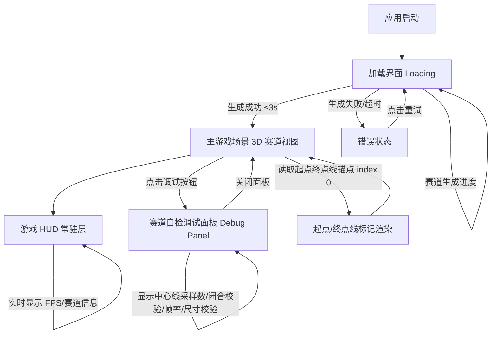
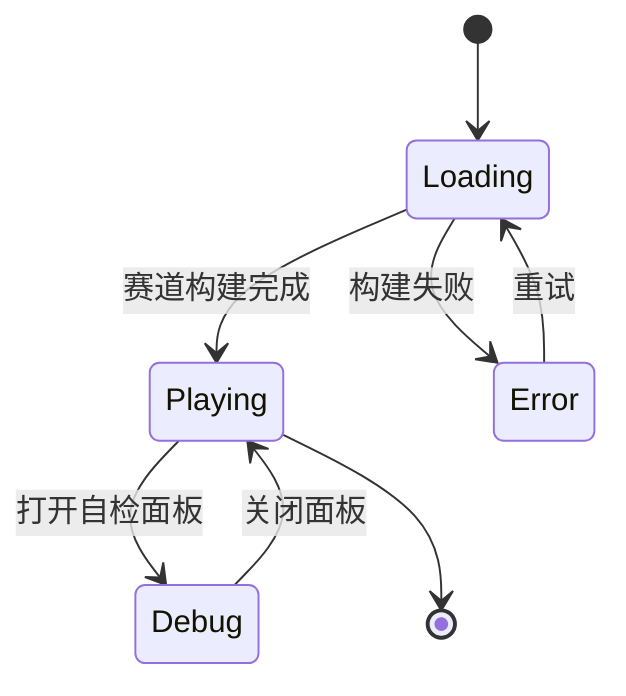

# UX 设计 — 构建 3D 环形赛道场景

> 所属需求：WebRacing3D 可玩原型 — 核心玩法验证

## 交互流程图



状态机补充：

```

## 组件线框说明

页面结构（单页游戏场景 + 悬浮 HUD 层）：

【Loading 加载层】全屏遮罩
- 中央：赛道生成进度条（0-100%）
- 文案：'正在构建环形赛道…'
- 底部：技术栈/版本小字

【主游戏场景层】全屏 3D 画布（Three.js WebGL）
- 赛道本体：路面（12m 宽）/ 两侧路肩（各 2m）/ 护栏（高 1m）/ 外围草地（≥50m 扩展）
- 起点/终点线：中心线 index 0 处横向标线

【HUD 常驻层】游戏内悬浮组件
- 左上角信息区：
  - FPS 计数器（实时刷新）
  - 赛道状态徽标（中心线采样点数 / 闭合状态）
- 右上角操作区：
  - 调试按钮（齿轮图标，切换自检面板）
- 顶部居中：场景标题 '环形赛道原型'
- 底部居中：控制提示条（相机旋转/缩放说明，仅桌面）

【Debug 自检面板】右上角抽屉式弹层
- 标题：'赛道自检'
- 指标列表：中心线采样点数、相邻点最大间距、首尾闭合距离、路面/路肩/护栏尺寸、自交检测结果、帧率
- 每项：指标名 + 数值 + 通过/未通过状态徽标
- 底部：'关闭' 按钮

【错误状态层】全屏或局部
- 图标 + 文案 '赛道构建失败'
- '重试' 按钮

## 交互状态定义

【调试按钮（齿轮）】
- normal: 默认可见可点击
- hover: 图标亮度提升，轻微放大
- active: scale 0.95 + 亮度变化
- disabled: opacity 0.4，cursor not-allowed（赛道未就绪时禁用）
- loading: 显示 spinner（生成过程中禁用点击）
- success: 面板成功打开后短暂高亮 1s

【重试按钮（错误层）】
- normal: 主色填充
- hover: 亮度提升
- active: scale 0.95
- disabled: 重试进行中 opacity 0.4
- loading: 显示 spinner，防重复点击
- success: 重试成功跳转 Loading 层

【关闭按钮（Debug 面板）】
- normal: 可见
- hover: 亮度变化
- active: scale 0.95
- disabled: 不适用
- loading: 不适用
- success: 不适用

【Debug 自检面板（抽屉）】
- default: 收起状态（仅齿轮按钮可见）
- expanded: 展开显示指标列表
- loading: 指标计算中显示骨架占位
- error: 单指标校验失败显示红色未通过徽标
- empty: 无数据时显示 '暂无自检数据'

【进度条（Loading 层）】
- loading: 进度递增动画
- success: 100% 后短暂显示完成态，随后进入主场景
- error: 构建失败时进度条暂停并跳错误层

【HUD 信息区】
- normal: FPS 与赛道状态实时刷新
- empty: 中心线数据未生成时显示 '--'
- error: 帧率异常/闭合失败时红色警示

【起点/终点线标记】
- normal: 稳定渲染于中心线 index 0
- active: 无交互（非可交互元素，仅视觉锚点）

## 响应式/适配规则

断点：mobile < 768px / tablet 768-1024px / desktop > 1024px

【desktop > 1024px】
- 完整 HUD 常驻层全部显示
- FPS 计数器与赛道状态徽标横向并排于左上
- Debug 面板为右上抽屉，宽 320px，从右滑入
- 底部控制提示条显示完整文字
- 3D 场景全屏，相机自由旋转/缩放

【tablet 768-1024px】
- HUD 保留 FPS + 调试按钮，赛道状态徽标折叠为图标+数字
- Debug 面板宽 280px
- 底部控制提示条精简为图标示意

【mobile < 768px】
- 本工单边界条件明确不含移动端/触屏适配，仅保留可运行降级视图
- HUD 仅显示 FPS 计数（左上）与调试按钮（右上）
- Debug 面板改为全屏底部抽屉（Bottom Sheet），占屏高 60%，自下而上滑入
- 隐藏底部控制提示条
- 触控手势：单指旋转相机、双指缩放（若后续启用）

通用规则：
- HUD 组件随画布同比例缩放，不遮挡赛道核心可视区
- 弹窗/面板出现 200ms 从下向上 + fade，消失 150ms fade out
- Loading 与错误层覆盖全屏，居中布局

## UI 资产清单（初稿）

- icon: debug（调试/自检面板开关，24px，outline 风格）
- icon: retry（错误重试按钮，24px，outline 风格）
- icon: close（关闭 Debug 面板，20px，outline 风格）
- icon: check（校验通过状态徽标，16px，outline 风格）
- icon: warning（校验失败/闭合异常警示，16px，outline 风格）
- icon: flag（起点/终点线锚点标识，24px，filled 风格）
- icon: gauge（FPS 计数器前缀，16px，outline 风格）
- illustration: loading-track（赛道构建加载插画，400x300，程序化环形赛道俯视示意，用于 Loading 层）
- illustration: error-state（构建失败空态插画，400x300，断口赛道警示示意，用于错误层）
- image: 无需外部图片（本工单全程序化几何体与占位材质，无贴图/背景图需求）
