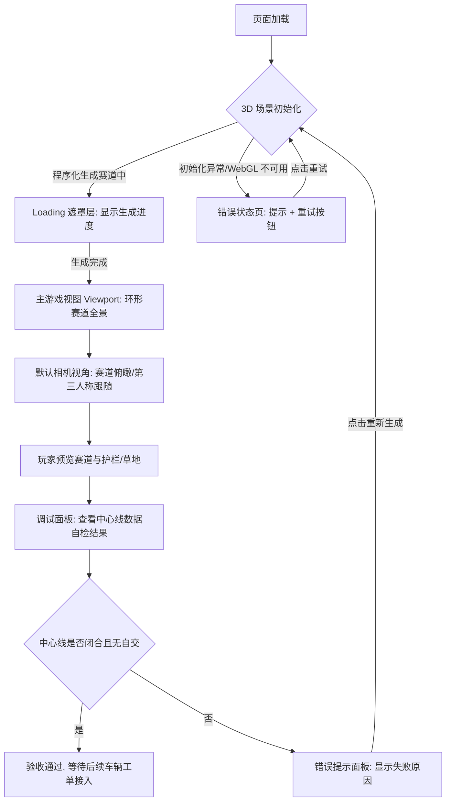

# UX 设计 — 构建 3D 环形赛道场景

> 所属需求：WebRacing3D 可玩原型 — 核心玩法验证

## 交互流程图

## 组件线框说明

页面整体为全屏游戏画布结构，共 4 个区域：

【1. 游戏视口 Viewport（主区域，占满全屏）】
- 全屏 3D 场景容器（渲染路面/路肩/护栏/草地）
- 内部只承载场景对象，不包含 UI 交互控件

【2. 顶部 HUD 栏（覆盖在视口上方，透明底）】
- 左侧：标题/场景名称文本
- 右侧：按钮组（相机视角切换、调试面板开关）

【3. Loading 遮罩层（全屏覆盖，加载时显示）】
- 中央：spinner + 生成进度文案
- 仅初始化阶段可见，生成完成后淡出

【4. 调试面板（右侧抽屉，可折叠）】
- 中心线数据自检结果：采样点数、闭合状态、自交检测、帧率
- 常量配置展示：路面宽/路肩宽/护栏高
- 起点线坐标（中心线 index 0）

【5. 错误/空状态提示面板（居中弹窗）】
- 图标 + 错误原因文案 + 重试/重新生成按钮

## 交互状态定义

【相机视角切换按钮】
- normal: 默认可点击
- hover: 背景微亮
- active: scale 0.95 + 亮度变化
- disabled: 场景未就绪时禁用，opacity 0.45，cursor not-allowed
- loading: 无（纯本地视角切换，无异步）
- selected: 当前视角高亮边框/勾选标识

【调试面板开关按钮】
- normal / hover / active / disabled（同上）
- on: 开关开启态主色高亮
- off: 关闭态灰显

【Loading 遮罩层】
- loading: 显示 spinner + 进度文案
- 完成: 150ms fade out 后移除

【重试/重新生成按钮】
- normal / hover / active 常规三态
- loading: 点击后显示 spinner，禁止重复点击
- disabled: 生成中禁用

【错误/空状态面板】
- error: 显示错误图标 + 原因文案 + 重试按钮
- empty: WebGL 不可用/场景未渲染时显示引导文案

【调试面板数据区】
- default: 正常展示中心线自检结果
- loading: 中心线生成中显示骨架占位
- error: 自检失败时对应项红色标识
- success: 自检通过项绿色勾选

## 响应式/适配规则

断点定义：mobile < 768px / tablet 768-1024px / desktop > 1024px

【desktop > 1024px】
- 全屏 Viewport，HUD 栏横排显示标题与按钮
- 调试面板为右侧抽屉，宽度约 320px
- 相机切换按钮完整显示图标+文字

【tablet 768-1024px】
- Viewport 仍全屏，HUD 栏压缩间距
- 调试面板改为底部滑出抽屉
- 相机切换按钮仅显示图标，文字隐藏

【mobile < 768px】
- 全屏 Viewport，HUD 栏仅保留标题 + 折叠菜单
- 调试面板改为底部全宽抽屉
- 相机切换按钮收进折叠菜单
- 触控区域不小于 44x44px

注：本工单无后端接口，不涉及网络错误重试；响应式主要影响 HUD 与调试面板布局，3D 场景始终全屏自适应。

## UI 资产清单（初稿）

icon: camera-view（相机视角切换，24px，outline 风格）
icon: debug-panel（调试面板开关，24px，outline 风格）
icon: retry（重试/重新生成，24px，outline 风格）
icon: check（自检通过标识，16px，outline 风格）
icon: warning（自检失败/错误标识，16px，outline 风格）
icon: menu（移动端折叠菜单，24px，outline 风格）
illustration: empty-state（WebGL 不可用/场景未渲染空状态，400x300）
illustration: error-state（场景初始化失败错误状态，400x300）
image: 无（本工单全部程序化几何体与占位材质，无需贴图/横幅图片）
