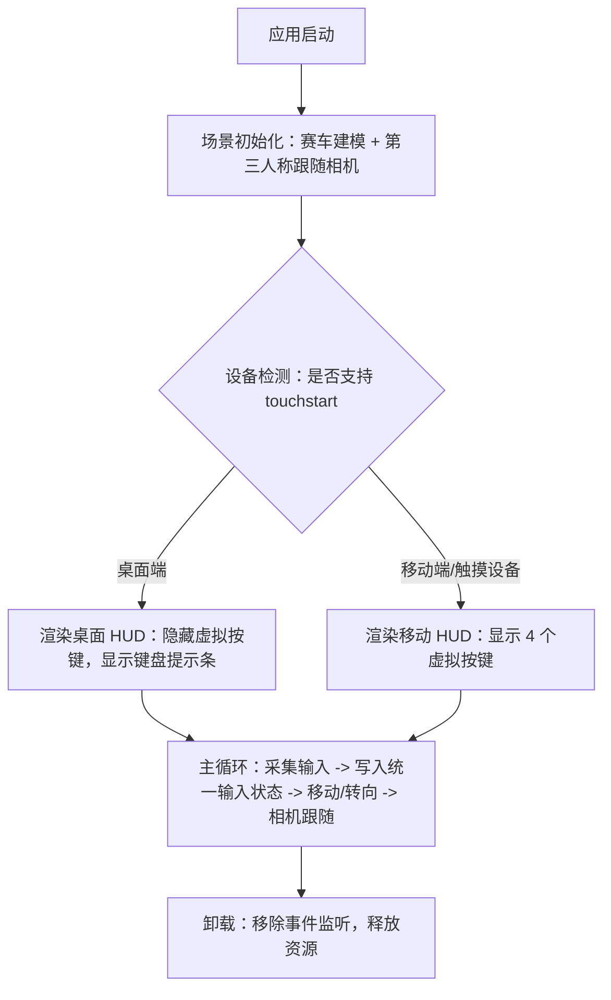
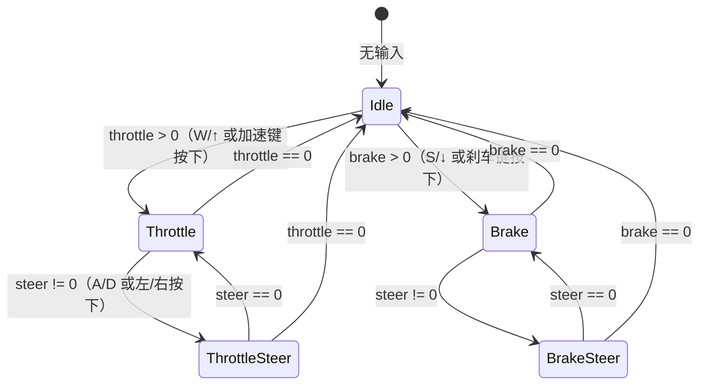

# UX 设计 — 实现玩家赛车与第三人称跟随视角

> 所属需求：WebRacing3D 可玩原型 — 核心玩法验证

## 交互流程图




```

## 组件线框说明

全屏 3D 场景视口（canvas，覆盖全屏，z-index 底层）
├── 玩家赛车 Group（场景根节点，统一控制位置/朝向）
│   ├── 车身主体（BoxGeometry，纯色材质）
│   ├── 驾驶舱（BoxGeometry，纯色材质，与车身区分）
│   └── 车轮 ×4（CylinderGeometry，独立子节点，预留旋转动画）
├── 第三人称跟随相机（位于赛车后方上方：后向偏移 8~12 + 高度 3~5，阻尼/lerp 插值，看向赛车前方目标点）
└── HUD 覆盖层（绝对定位，pointer-events 分层：背景层不拦截，按键层可交互）
    ├── 左上角：速度/状态指示器（可选，实时展示 throttle/brake/steer 轴值）
    ├── 底部中央：桌面端键盘操作提示条（W/S/A/D/方向键说明，移动端隐藏）
    ├── 左下角：移动端转向按键组（左转、右转，纵向/横向排布）
    └── 右下角：移动端油门/刹车按键组（加速、刹车/倒车，纵向排布）

层级说明：虚拟按键与键盘写入同一输入状态（throttle/brake/steer 三轴，[-1,1]），移动/转向逻辑只读统一状态，不直接触碰输入对象。

## 交互状态定义

1. 虚拟按键（加速/刹车/左转/右转，移动端）
   - normal：默认半透明可点按，响应 touchstart/touchend
   - hover：仅 Web 悬停时亮度微增（移动端无 hover 态）
   - active/pressed：scale 0.95 + 亮度提高，立即写入对应轴（throttle/brake/steer）
   - disabled：opacity 0.4，不响应（场景未就绪时）
   - loading：场景初始化阶段不渲染虚拟按键，避免误触
   - multi-touch：同时按住加速+左转时，throttle 与 steer 两轴独立生效、互不覆盖
   - release：touchend/touchcancel 立即归零对应轴，无粘滞

2. 键盘输入（W/↑、S/↓、A/D/←→，桌面端）
   - pressed：keydown 置位对应轴（1 或 -1），重复 keydown 忽略，防粘滞
   - released：keyup 立即归零对应轴
   - multi-key：W+A 同时按下，throttle 与 steer 并行写入，互不影响

3. 桌面键盘提示条
   - normal：静态展示按键说明
   - hidden：移动端/触摸设备隐藏（display:none）

4. 加载遮罩
   - loading：spinner/骨架屏，场景构建期间显示
   - success：赛车与相机就绪后 2s 内淡出移除

5. 速度/状态指示器（可选）
   - normal：实时刷新轴值
   - idle：三轴均为 0 时显示归零态
   - hidden：桌面/移动端均常驻，无异常态

通用原则：所有输入组件状态变更通过受控 action 方法写入统一输入状态，禁止在渲染循环中直接改内部对象。

## 响应式/适配规则

断点：mobile < 768px / tablet 768-1024px / desktop > 1024px

虚拟按键显隐以「是否支持 touchstart」为准（触摸能力优先于宽度判断）：
- 支持 touchstart -> 渲染虚拟按键，不依赖键盘即可完整操作
- 不支持 touchstart（纯桌面）-> 不渲染虚拟按键，仅键盘输入

mobile < 768px：
- 显示虚拟按键，布局为左下角转向组 + 右下角油门/刹车组
- 按键触控热区 ≥ 64px，避免误触，支持多点触控


tablet 768-1024px：
- 若支持触摸则显示虚拟按键，热区适当放大（≥ 72px）
- 同时兼容键盘输入，两者信号一致

desktop > 1024px：
- 隐藏虚拟按键，仅键盘输入，显示键盘提示条
- 无触摸事件时不渲染任何虚拟按键 DOM

通用：赛车与相机位置随视口等比缩放，确保赛车完整可见、不被裁剪。

## UI 资产清单（初稿）

icon: accelerate（触屏加速/油门按键，64px，游戏风格实心+描边，可用向上箭头/油门图标）
icon: brake（触屏刹车/倒车按键，64px，游戏风格实心+描边，可用向下箭头/刹车图标）
icon: left（触屏左转按键，64px，游戏风格实心+描边，可用左箭头）
icon: right（触屏右转按键，64px，游戏风格实心+描边，可用右箭头）
icon: keyboard-hint（桌面端键盘提示条图标，24px，outline 风格，可选，用于 W/S/A/D 说明）
icon: speed（速度/状态指示器图标，24px，outline 风格，可选，用于速度显示）
