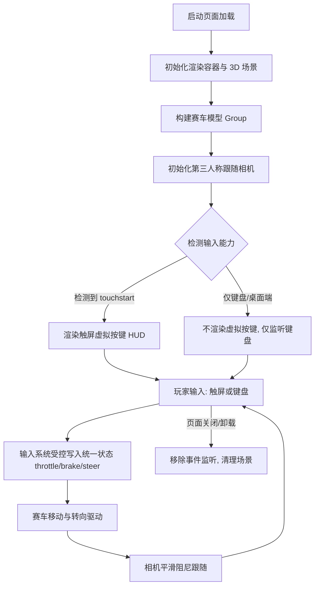

# UX 设计 — 实现玩家赛车与第三人称跟随视角

> 所属需求：WebRacing3D 可玩原型 — 核心玩法验证

## 交互流程图


```

## 组件线框说明

页面为单屏全屏游戏界面，采用「全屏 3D 画布 + HUD 覆盖层」双层结构：

【1. 全屏 3D 渲染容器】
- 占满整个视口，承载 Three.js 场景，赛车模型居中偏下，第三人称相机从后方上方取景。

【2. HUD 覆盖层（透明覆盖于画布之上，pointer-events 按需穿透）】
- 虚拟按键区（仅触摸设备渲染）：
  - 左下角：左转按键
  - 右下角：右转按键
  - 右侧偏上或右下竖排：加速按键（主键，面积更大）
  - 加速键下方/相邻：刹车/倒车按键
  - 推荐布局：左侧横向排布「左转」，右侧排布「右转 + 加速 + 刹车」，符合赛车手游拇指习惯。
- 状态占位区（本工单预留，不强制）：
  - 顶部中间：可后续放计时/圈数信息（本工单不实现，仅预留容器）。

【3. 非交互层】
- 相机无 UI 元素；赛车为 3D 实体不属 HUD。

## 交互状态定义

触屏虚拟按键（加速/刹车/左转/右转，共 4 个，语义一致）：

- 默认(normal)：半透明可见，可点按。
- 按下(active/pressed)：视觉反馈 scale 0.92 + 高亮/亮度提升，同时写入对应输入轴为 ±1；支持多点触控，多个按键可同时处于 pressed 状态（如加速 + 左转）。
- 释放(released→normal)：恢复默认样式，输入轴归零（200ms 内完成）。
- 悬停(hover)：触摸设备无 hover 概念，不实现；若将来在支持鼠标的触摸平板出现，hover 仅做轻微高亮，不触发输入。
- 禁用(disabled)：opacity 0.4，不响应触摸（本工单默认无禁用场景，保留状态定义供后续如「未开始/结算暂停」复用）。
- 加载中(loading)：本工单按键为纯控制按钮，无异步，不适用；保留定义供后续联网场景。
- 空(empty)/错误(error)：本工单按键不承载数据，不适用。

键盘输入（非 UI 组件，为输入源）：
- 按下(keydown)：写入对应轴；松开(keyup)：轴归零。W/↑→throttle=+1，S/↓→brake=+1（或 throttle=-1 的倒车语义，与触屏刹车键写入同一轴）。A/←→steer=-1，D/→→steer=+1。多键同时按下天然支持，无粘滞。

HUD 整体状态：
- 触摸设备：虚拟按键区可见。
- 桌面端：虚拟按键区不渲染（display none），画布全屏无遮挡。

## 响应式/适配规则

断点：mobile < 768px / tablet 768-1024px / desktop > 1024px

- mobile(<768px，触摸优先)：
  - 渲染虚拟按键区，按键触控目标尺寸 ≥ 64px，间距 ≥ 12px，贴边安全距离 ≥ 16px（避开刘海/手势区）。
  - 加速键为主键，尺寸最大（约 88-96px）；转向键约 64-72px。
  - 支持多点触控（需为每个按键独立绑定 touchstart/touchend，禁用默认手势如页面缩放/滚动）。
  - 默认横屏游玩，竖屏仅保证按键可用（不做布局优化，属 PRD 暂不支持项）。

- tablet(768-1024px)：
  - 若检测到触摸能力，同样渲染虚拟按键，按键尺寸可适当放大（转向 80px、加速 112px）。
  - 若为桌面平板（无触摸），按 desktop 规则处理。

- desktop(>1024px)：
  - 不渲染虚拟按键，仅监听键盘；画布全屏无遮挡，HUD 除预留状态区外不占交互空间。
  - 不监听 touch 相关按键逻辑。

通用：
  - 输入能力检测基于 'ontouchstart' in window 或 matchMedia('(pointer: coarse)')，在初始化时判定一次。
  - 相机与场景渲染随视口 resize 自适应（camera.aspect 更新），任意断点下保持赛车完整可见。

## UI 资产清单（初稿）

- icon: accelerate（触屏「加速」按键图标，车载油门/向上箭头语义，64px，filled 圆角风格，供主键使用，可放大至 96px）
- icon: brake（触屏「刹车/倒车」按键图标，向下/制动语义，64px，filled 圆角风格）
- icon: steer-left（触屏「左转」按键图标，向左箭头，64px，filled 圆角风格）
- icon: steer-right（触屏「右转」按键图标，向右箭头，64px，filled 圆角风格）
- illustration: 无需插画（本工单无空状态/错误态展示场景）
- image: 无需静态图片（赛车为 3D 几何体实时渲染，无贴图需求）
- 备注：4 个图标若暂无美术资源，可先用矢量文字符号（▲/▼/◀/▶ 或「油门/刹车/左/右」文字）占位，交互结构不变。
