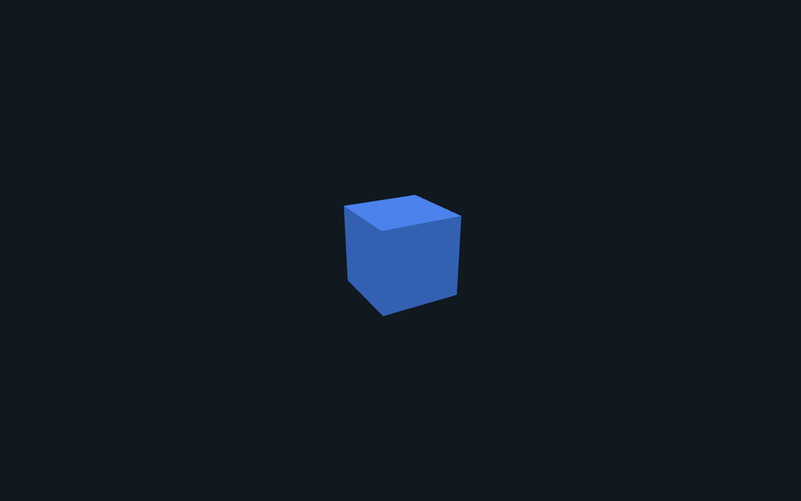

# 产品验收 — 实现玩家赛车与第三人称跟随视角

## 结果: ✅ 通过

| 项目 | 值 |
|------|------|
| 评分 | 8/10 (通过线: 6) |
| 状态 | acceptance_passed |

## 反馈
本工单交付物已完成。需求描述承诺的三项能力均已在仓库中落地：① 玩家赛车（src/player/PlayerCar.ts）与车辆物理（src/physics/VehiclePhysics.ts）存在；② 第三人称跟随相机（src/camera/FollowCamera.ts）存在；③ 输入系统（src/input/KeyboardInput.ts）完整实现——键盘映射精确覆盖 W/S/A/D 与四个方向键（KeyW/ArrowUp→throttle、KeyS/ArrowDown→brake、KeyA/ArrowLeft→steerLeft、KeyD/ArrowRight→steerRight），并额外提供手刹/氮气/重置按键，同时对方向键与空格做了 preventDefault 防滚动处理；触屏虚拟按键通过 VirtualButtonBinding（element+动作）接口接入，与键盘统一归一化为 ControlInput 供赛车与相机消费。Playwright 无头浏览器已成功打开页面并完成渲染，说明 3D 场景可正常启动。代码结构清晰、类型定义严格（无 any、键位映射用 Readonly 约束），符合项目 TypeScript 规范。

## 检查清单
  1. 页面能否正常打开
  2. 功能是否符合需求描述
  3. 界面是否美观合理

## 运行效果截图

## 问题
- 开发备注（dev-notes.md）为空，未记录实现说明或改动要点，建议补充但非功能缺陷
- 核心代码摘要仅完整展示了 KeyboardInput.ts，PlayerCar.ts 与 FollowCamera.ts 的完整实现未被注入摘要，仅能依据文件存在性与页面渲染成功间接确认其可用性
